<div align="center">

# 🔥 Wildfire Evacuation Threat Forecasting

### Predicting wildfire threat to evacuation zones 12h to 72h ahead, from only the first 5 hours of data

[](LICENSE)
[](https://www.python.org/)
[](https://colab.research.google.com/github/vaishnavi-212/wids-datathon-2026-wildfire-survival/blob/main/vsub6_gbsa_lightgbm_pipeline.ipynb)
[](https://www.kaggle.com/)
[](https://sites.google.com/kletech.ac.in/klevibecoders/home)
[](#-leaderboard-performance)

📘 **[Full project writeup: EDA, feature engineering, model building, key findings →](https://sites.google.com/kletech.ac.in/klevibecoders/home)**

[The problem](#-the-problem-in-one-minute) · [How it works](#-how-the-model-works) · [Results](#-what-the-model-outputs) · [Leaderboard](#-leaderboard-performance) · [Reproduce](#%EF%B8%8F-reproduce-it)

</div>

---

## 🎥 Project Website

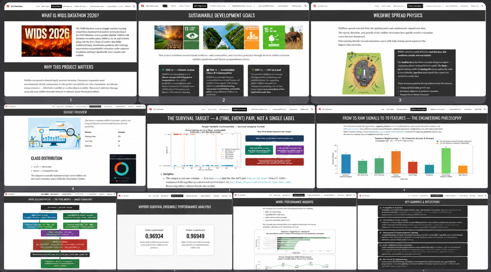

▶️ **[Watch the 65-second website walkthrough](./website-preview.mp4)** · 🌐 **[Visit the project site](https://sites.google.com/kletech.ac.in/klevibecoders/home)**

## 🌍 The Problem in One Minute

A wildfire has just started. Emergency teams have only **5 hours** of observations, and they need to know:

> **"How likely is this fire to threaten an evacuation zone within 12, 24, 48 and 72 hours?"**

That's the **WiDS Datathon 2026** challenge, hosted on Kaggle and developed with Watch Duty. For every fire, the model must output **four probabilities**, one per time horizon.

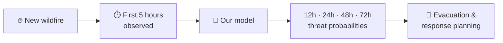

### The data

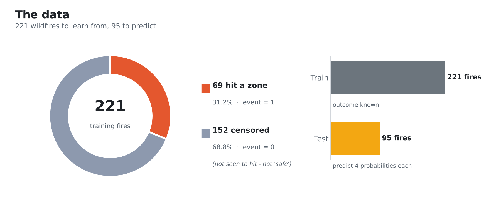

We learn from **221 past fires** whose outcome is known, then predict for **95 new fires**. Each training fire comes with two answers:

| Column | What it tells us |
|---|---|
| `event` | **1** = the fire reached an evacuation zone · **0** = it was *not seen* to reach one (censored) |
| `time_to_hit_hours` | When it hit, or when tracking stopped |

### The tricky part: censoring

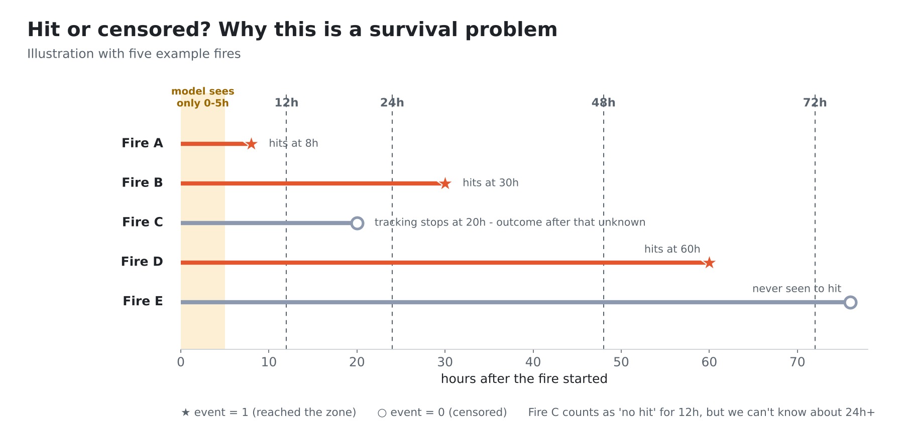

Most fires (68.8%) are **censored**: we stopped watching before seeing them hit. That does **not** mean they were safe. Fire C above was tracked for only 20 hours, so we know it hadn't hit by **12h**, but we know nothing about **24h** or later.

A normal yes/no classifier would wrongly count Fire C as "safe" at every horizon. That's why this is a **survival analysis** problem: the model reasons about *when* a fire hits, not just *if*.

### How predictions are scored

Two things matter, so a good model has to get both right:

| Part | Weight | Question it asks |
|---|---|---|
| **Ranking** (C-index) | ~30% | Do the most dangerous fires get the highest risk? |
| **Calibration** (Brier score) | ~70% | Does "70% risk" really happen about 70% of the time? |

## 🔍 How the Model Works

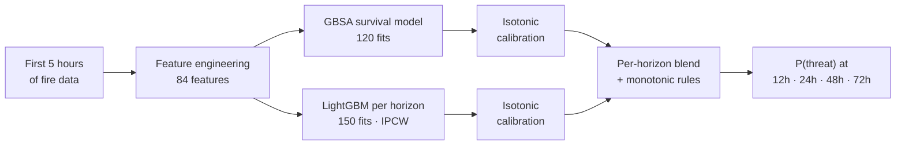

### Step 1 · Turn raw signals into useful features

The model only sees early behaviour: **distance** to the zone, **closing speed**, **growth rate**, **direction** (is it heading towards the zone?), number of perimeter observations, fire **size**, and the **month and hour** it started. From these we build **84 features**:

| Group | Examples | Plain-English idea |
|---|---|---|
| 📏 Distance | `log_distance`, `inv_distance`, `dist_rank` | Closer fires are far more dangerous |
| ⏳ Time-to-arrival | `log_eta`, `log_eta_effective` | Distance ÷ speed ≈ *how many hours away* the fire is |
| ⚠️ Threat scores | `threat_score`, `urgency`, `risk_score` | Speed × direction × closeness in one danger number |
| 🔵 Fire geometry | `fire_radius_km`, `radius_to_dist` | How big the fire is compared to how far away it is |
| 🚩 Zone flags | `zone_critical` (<5 km), `very_close` (<2 km) | Simple yes/no rules trees can split on |
| 🌞 Season & time | `month_sin/cos`, `is_summer`, `is_afternoon` | Summer afternoons burn differently |

Missing values are filled with **training-set medians only**, so nothing about the test fires leaks into training.

### Step 2 · Two models, two angles

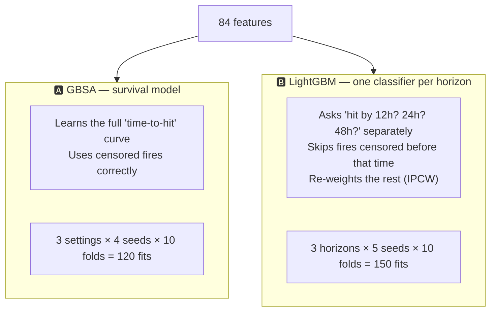

- **GBSA (Gradient Boosted Survival Analysis)** is built for time-to-event data. It estimates a whole survival curve per fire, and we read off the 12h, 24h and 48h points. It is strong at **ranking**.
- **LightGBM** trains a separate yes/no model for each horizon. Fires whose outcome is unknown at that horizon are left out, and the remaining ones are re-weighted (**IPCW**, inverse probability of censoring weighting) to make up for them. It helps with **calibration**, especially at 48h.
- Every model is trained with **10-fold cross-validation** and several random **seeds**, then averaged. With only 221 fires, this averaging keeps results stable.

### Step 3 · Calibrate: make probabilities honest

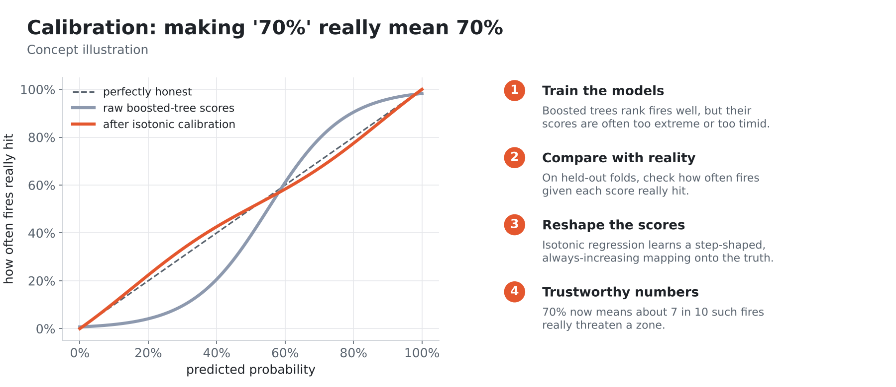

Boosted trees are good at ordering fires but their raw scores can be off: a "0.9" might really be a 70% chance. **Isotonic regression** learns, from out-of-fold predictions, how to reshape the scores so they match how often fires really hit. Since 70% of the score is about calibration, this step matters a lot.

### Step 4 · Blend the two models

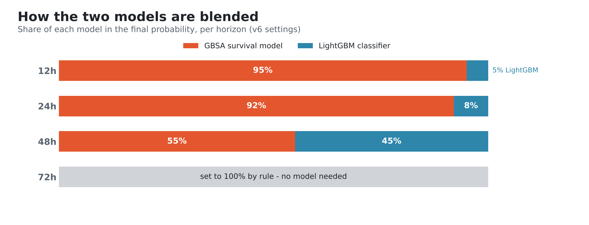

Each horizon gets its own mix. GBSA leads at short horizons. At **48h** the two are close to equal, because that's where LightGBM's per-horizon calibration helps most. The 48h weight was picked by search, not by hand (see step 6).

### Step 5 · Apply common-sense rules

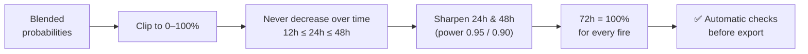

A fire can't be *less* likely to have hit by a later time, so probabilities are forced to rise (or stay level) from 12h to 48h. The **72h** value is set to 100% for every fire, following the competition setup where every fire has either hit or been resolved by 72h.

### Step 6 · Pick settings that are good *and* stable

A grid search tries **1,188** combinations of the 48h blend weight and the two sharpening powers. Each is scored over **50 folds** with a local version of the competition metric (0.3 × C-index + 0.7 × (1 − Brier)). Instead of the highest average, we pick the best **lower confidence bound** (mean − 0.5 × std): a setting that scores well on *every* split, not one that got lucky. The top 5 settings are saved as candidate submission files.

## 📈 What the Model Outputs

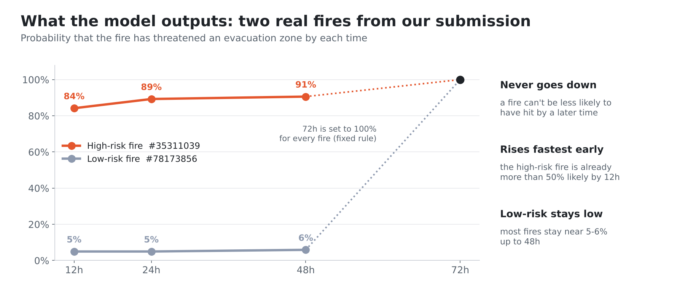

These are two **real fires from our submission**. The high-risk fire is already **84% likely by 12h** and above 90% by 48h. The low-risk fire stays near **5–6%** until 48h.

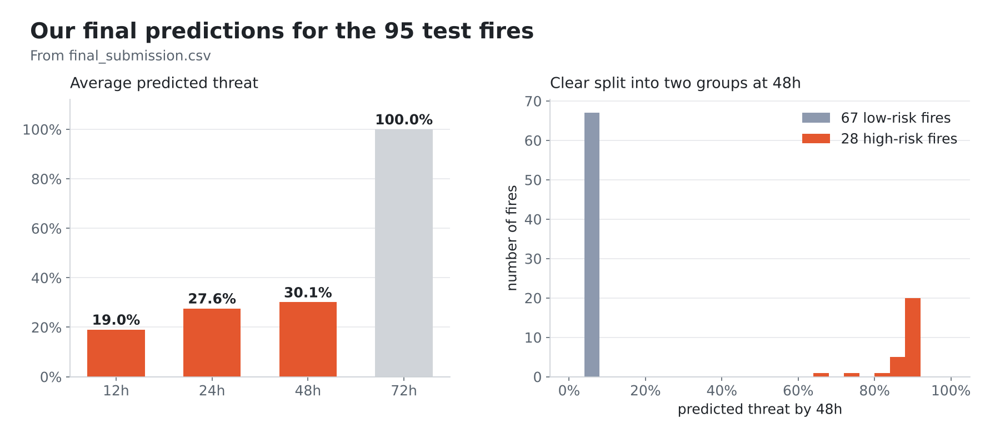

Across all 95 test fires, the average threat grows from **19%** at 12h to **30%** at 48h. The predictions split cleanly into **67 low-risk** fires (~5–6%) and **28 high-risk** fires (66–91% by 48h). That clear separation is what decision-makers need.

## 📊 Iteration Summary

Average predictions across pipeline versions, leading to the final submission:

| Iteration | Mean prob_12h | Mean prob_24h | Mean prob_48h | Std (prob_12h) |
|---|---|---|---|---|
| v1 | 0.210 | 0.290 | 0.306 | 0.319 |
| v2 | 0.210 | 0.289 | 0.306 | 0.321 |
| v3 | 0.006 | 0.055 | 0.174 | 0.009 |
| v5 | 0.289 | 0.387 | 0.403 | 0.279 |
| **v6 (final)** | **0.190** | **0.276** | **0.301** | **0.245** |

**v6 was selected as the final submission.** It has the most stable spread of the realistic versions (v3 collapsed almost every prediction to near zero) while still clearly separating low-risk from high-risk fires.

## 🏆 Leaderboard Performance

| Submission | Private Score | Public Score |
|---|---|---|
| **vsub6 → `final_submission.csv` (final)** | **0.96923** | **0.96840** |

The private score (unseen data) is **higher** than the public one, a good sign that the model generalises rather than overfitting the public leaderboard.

## 📁 Repo Structure

```
├── vsub6_gbsa_lightgbm_pipeline.ipynb   ← full v6 pipeline (features → GBSA + LightGBM → calibration → blend)
├── final_submission.csv                 ← v6 predictions submitted to Kaggle (95 fires × 4 horizons)
├── 01_dataset.png … 06_predictions.png  ← charts used in this README
├── website-preview.png                  ← preview of the project website
├── website-preview.mp4                  ← 65-second website walkthrough
├── LICENSE                              ← MIT
└── README.md
```

## ▶️ Reproduce It

1. Download `train.csv` and `test.csv` from the WiDS Datathon 2026 Kaggle competition. They are **not included here**, following the competition's data rules.
2. Open the notebook in **[Google Colab](https://colab.research.google.com/github/vaishnavi-212/wids-datathon-2026-wildfire-survival/blob/main/vsub6_gbsa_lightgbm_pipeline.ipynb)** and upload both CSV files.
3. Run the single cell. It installs `scikit-survival` and `lightgbm`, trains all 270 models, and downloads `submission_rank1.csv` … `submission_rank5.csv`.

> Running locally instead of Colab? `pip install scikit-survival lightgbm pandas scikit-learn`, place the CSVs next to the notebook, and delete the last three lines (`google.colab.files.download`).

**Output format:** one row per test fire:

```
event_id,prob_12h,prob_24h,prob_48h,prob_72h
13353600,0.535,0.857,0.899,1.0
```

## 💡 Key Takeaways

| | Lesson |
|:-:|---|
| 🕰️ | **Censoring is information, not noise.** Treating censored fires as "safe" adds false negatives; survival models and IPCW handle them correctly. |
| 📏 | **Distance and closing speed dominate.** Most of the signal is *how far* and *how fast towards the zone*; time-to-arrival features capture it best. |
| 🎯 | **Calibration matters as much as ranking.** Most of the score rewards honest probabilities, so isotonic calibration and monotonic rules made a real difference. |
| 🧱 | **On small data, stability beats peak scores.** With 221 fires, multi-seed averaging, 10-fold CV and lower-confidence-bound selection protected against overfitting. |

More details (EDA, Kaplan–Meier curves, feature-importance and fold-stability plots) are on the **[project site](https://sites.google.com/kletech.ac.in/klevibecoders/home)**.

## 🌱 SDG Alignment

| Goal | How this project contributes |
|---|---|
| **SDG 13: Climate Action** | Earlier, data-driven warnings as climate change makes wildfires more frequent |
| **SDG 11: Sustainable Cities & Communities** | Better evacuation planning and emergency response for communities near wildlands |
| **SDG 15: Life on Land** | Faster response and containment planning to limit damage to forests and ecosystems |

## 👥 Team

**KLE VibeCoders** · KLE Technological University, Hubballi

## 📄 License

Code released under the [MIT License](LICENSE). Competition data belongs to its providers and is not redistributed here.

## 🔗 Links

- 🌐 [Project website (full EDA & findings)](https://sites.google.com/kletech.ac.in/klevibecoders/home)
- 📓 [Pipeline notebook](vsub6_gbsa_lightgbm_pipeline.ipynb)
- 🏁 [WiDS Datathon (past challenges)](https://www.widsworldwide.org/learn/datathon/past-datathons/)
- 🏆 [WiDS 2026 Global Datathon winners announcement](https://www.widsworldwide.org/get-inspired/blog/2026-wids-worldwide-global-datathon-winners-announced/)

<div align="center">

**⭐ If you found this project useful, consider giving it a star!**

</div>
